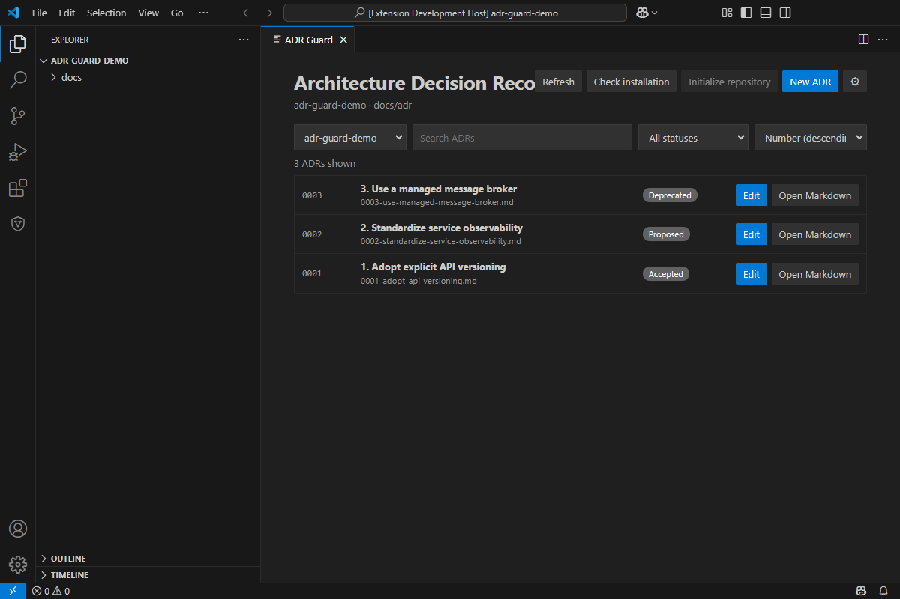

# ADR Guard

[](https://github.com/rodri-oliveira-dev/adr-guard/actions/workflows/ci.yml)
[](https://www.nuget.org/packages/RodriOliveira.AdrGuard)
[](https://marketplace.visualstudio.com/items?itemName=rodrioliveira.adr-guard)
[](https://github.com/rodri-oliveira-dev/adr-guard/releases)

[](LICENSE)

[Português (Brasil)](README.pt-BR.md) · [Documentation portal](https://rodri-oliveira-dev.github.io/adr-guard/) · [Markdown documentation](docs/index.md) · [Changelog](CHANGELOG.md)

**Understand architectural decisions. Record the reasoning. Keep the history trustworthy.**

ADR Guard is a lightweight .NET command-line tool for creating, validating, reviewing, and indexing Architecture Decision Records (ADRs). It keeps decision documentation consistent in local development and CI without making architectural decisions for your team.

## What is an ADR?

An ADR is a short document that explains one consequential software decision: the context that required it, the option selected, and the benefits and costs that follow. ADRs help future contributors understand **why** a system was shaped a certain way—not only what the code does.

New to the practice? Follow the progressive guide:

1. [What is an ADR?](docs/fundamentals/what-is-an-adr.md)
2. [Why and when should a team use ADRs?](docs/fundamentals/why-use-adrs.md)
3. [Write and validate your first ADR](docs/guides/getting-started.md)

## What ADR Guard does

- creates offline `Proposed` ADRs from Minimal, Extended, or constrained Custom templates;
- validates canonical structure, filenames, statuses, required sections, links, IDs, and supersession relationships;
- supports separate, opt-in MADR 4.0 validation;
- generates a deterministic Markdown index only after validation succeeds;
- supports Git-aware incremental checks, diagnostic baselines, and JSON/SARIF reports;
- offers opt-in, advisory [architecture impact analysis](docs/guides/architecture-impact-analysis.md) from explicit ADR-to-code mappings;
- verifies opt-in [architectural drift and fitness evidence](docs/guides/architectural-drift.md) without evaluating MSBuild or treating missing evidence as compliance;
- offers opt-in, human-reviewed AI drafting and technical review with explicit providers and context;
- integrates with GitHub Actions, VS Code, versioned container images, and an optional independently packaged MCP server for compatible agents.

Validation confirms deterministic documentation rules. It does **not** approve technical merit, authorize a decision, or turn AI output into an accepted architecture.

## Install

Install the published .NET Tool from NuGet.org:

```bash
dotnet tool install --global RodriOliveira.AdrGuard
adr-guard --version
```

Update an existing installation with `dotnet tool update --global RodriOliveira.AdrGuard`. GitHub Packages is also available as an authenticated secondary registry. See [GitHub Releases](https://github.com/rodri-oliveira-dev/adr-guard/releases) or the NuGet badge for the current published version.

## Quick start

From the root of an existing repository:

```bash
adr-guard init . --adr-directory docs/adr --template minimal
adr-guard new docs/adr --title "Use PostgreSQL as the order system of record"
```

Edit the generated `Proposed` ADR to replace its guidance with your real context, decision, and balanced consequences. Review it with the people affected by the choice, then run:

```bash
adr-guard check docs/adr
adr-guard index docs/adr
```

`check` validates the ADR set. `index` validates again and creates or updates `docs/adr/README.md`; `new` does not update the index automatically. Read the [first ADR tutorial](docs/guides/getting-started.md) for the complete workflow.

## Choose the right structure

| Option | Use it when | Product boundary |
| --- | --- | --- |
| Minimal | Core context, choice, rationale, and consequences are enough | Generated by `new`/`draft`; canonical validation |
| Extended | Options, drivers, risks, or cross-team impact need explicit treatment | Generated by `new`/`draft`; canonical validation; **not MADR** |
| Custom | A team needs additional canonical prompts or sections | One strict local file via `--template-file`; not arbitrary Markdown |
| MADR 4.0 | The team deliberately uses MADR's external structure | Separately authored; opt-in `--adr-format madr-4`; no built-in `new` generator |

See the [selection matrix](docs/decision-design/choosing-a-template.md), [complete examples](docs/examples/README.md), [custom template contract](docs/custom-templates.md), and [MADR compatibility guide](docs/madr-4.md).

## Integrations

| Integration | Use | Guide |
| --- | --- | --- |
| GitHub Action | Validate, index, or explicitly run AI review/architecture impact analysis on supported Linux runners | [Consumer guide](docs/github-action.md) |
| VS Code | Visual ADR management, architecture/governance workflows, commands, Problems diagnostics, and ADR Explorer through a compatible installed CLI | [Extension guide](extensions/vscode/README.md) |
| MCP server | Give compatible agents structured, read-only access to ADR discovery, validation, impact, and drift tools | [MCP overview](docs/mcp.md) |
| Containers | Run the same versioned CLI from GHCR or Docker Hub | [Container and supply-chain guide](docs/container.md) |
| CI reports | Produce text, JSON, or SARIF validation output | [Check reports](docs/check-reports.md) |
| Agent Skills | Give agents portable instructions for human-controlled ADR and CLI workflows | [Skills guide](docs/skills/README.md) |

The prepared release set is CLI `1.8.0`, VS Code `1.1.0`, and MCP `1.0.0`. These are independent versions, and none of those candidates is made public by this branch or PR. The verified public baseline is CLI `1.7.0` and VS Code `1.0.0`; no ADR Guard MCP package or Registry entry is public. See the [compatibility matrix](docs/compatibility.md) for minimum CLI contracts, .NET/VS Code requirements, optional dependencies, and operation without MCP.

The [published ADR Guard for VS Code extension](https://marketplace.visualstudio.com/items?itemName=rodrioliveira.adr-guard) includes the visual ADR list plus guided creation, editing, and settings. These screens require the CLI 1.7.0 form contracts. Extension and CLI versions remain independent.



See the [extension source and installation guide](extensions/vscode/README.md) and the portal's [VS Code Visual Guide](https://rodri-oliveira-dev.github.io/adr-guard/product/vscode-visual-guide/) for the complete interface walkthrough.

Structured ADR creation and editing are implemented for trusted visual clients such as the VS Code extension. A compatible CLI from the 1.7.0 line exposes `new <directory> --form` and `edit <file> --form` as versioned JSON stdin/stdout contracts; they are not interactive terminal forms. The traditional `new --title` workflow remains the human-facing command-line path, including constrained custom templates. See the [creation guide](docs/creation.md), [CLI contract reference](docs/cli-reference.md), and [extension guide](extensions/vscode/README.md). Confirm that both the CLI and extension versions providing the visual forms have been published before relying on them.

The [GitHub Marketplace Action](https://github.com/marketplace/actions/adr-guard-architecture-decision-validator) and [Visual Studio Marketplace extension](https://marketplace.visualstudio.com/items?itemName=rodrioliveira.adr-guard) are published. The moving `@v1` tag is published and supports `check`, `index`, opt-in `review` since v1.1.6, and opt-in `impact` since v1.5.0. In v1.6.0, `drift` is provided through the CLI/direct-container workflow, alongside `new` and `draft`; it is not a composite Action mode. The extension does not bundle the CLI.

The independent MCP `1.0.0` candidate, `RodriOliveira.AdrGuard.Mcp` packaging, Registry manifest, and manual release pipeline are implemented and tested in source. They remain unpublished until the first authorized `MCP Release` run completes and verifies NuGet.org, GitHub Releases, and the Registry; use a local package or source build meanwhile. See [MCP configuration](docs/mcp-configuration.md), [available tools](docs/mcp-tools.md), [VS Code integration](extensions/vscode/README.md#mcp-integration), and [security and permissions](docs/mcp-security.md).

## Agent Skills (P0 + P1)

Eleven portable [Agent Skills](docs/skills/README.md) cover ADR setup, creation, validation, technical review, lifecycle management, CI setup, when to write ADRs, trade-off analysis, supersession, audits, and team adoption. The skills guide agents in using ADR Guard; they do not install the CLI or make architectural approvals.

```bash
npx skills add rodri-oliveira-dev/adr-guard --list
npx skills add rodri-oliveira-dev/adr-guard --skill adr-guard-create --agent codex
```

The eleven Agent Skills are available on the default branch. See [installation, safeguards, and scope](docs/skills/README.md) to select and install only the workflows you need.

## Documentation

- **Learn:** [fundamentals](docs/index.md#learn-the-practice), [decision categories](docs/decision-design/decision-categories.md), [lifecycle](docs/fundamentals/lifecycle.md), and [anti-patterns](docs/decision-design/anti-patterns.md).
- **Use:** [first ADR tutorial](docs/guides/getting-started.md), [team adoption](docs/guides/team-adoption.md), and [offline creation](docs/creation.md).
- **Reference:** [CLI and configuration](docs/cli-reference.md), [compatibility matrix](docs/compatibility.md), [validation and governance](docs/relationship-governance.md), and [full technical index](docs/index.md#technical-reference).
- **Architecture analysis:** [impact analysis](docs/guides/architecture-impact-analysis.md), [architectural drift](docs/guides/architectural-drift.md), [diagnostic baselines](docs/incremental-validation.md), and [AI review](docs/adr-review.md).
- **MCP:** [overview](docs/mcp.md), [configuration](docs/mcp-configuration.md), [tool contracts](docs/mcp-tools.md), and [security](docs/mcp-security.md).
- **AI boundaries:** CLI review has been published since v1.1.2 and runs explicitly as `adr-guard review`; deterministic policy enforcement may return exit code `4`. See the [AI review guide](docs/adr-review.md), [draft privacy](docs/draft-templates.md), and [review security](docs/adr-review-security.md).
- **Project architecture:** [ADR Guard's own generated ADR index](docs/adr/README.md).

English is the default documentation language. Brazilian Portuguese pages use `.pt-BR.md` and are linked from each translated page.

## Build and contribute

The project targets .NET 10. To build and test from source:

```bash
dotnet restore AdrGuard.slnx
dotnet build AdrGuard.slnx --no-restore
dotnet test AdrGuard.slnx --no-build
```

Issues and focused pull requests are welcome. Use the [issue tracker](https://github.com/rodri-oliveira-dev/adr-guard/issues) for proposals and reproducible bugs, [SUPPORT.md](SUPPORT.md) for support, and [SECURITY.md](SECURITY.md) for private vulnerability reporting.

## Releases and license

Published artifacts and exact version notes are available in [GitHub Releases](https://github.com/rodri-oliveira-dev/adr-guard/releases). Repository release notes remain under [`docs/releases`](docs/releases/).

ADR Guard is licensed under the [MIT License](LICENSE).
