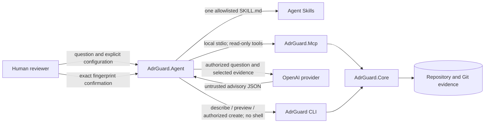

# Architecture Agent (development-only)

[Português (Brasil)](architecture-agent.pt-BR.md) · [MCP overview](mcp.md) · [Security model](mcp-security.md)

The optional `AdrGuard.Agent` source project contains read-only architectural-question flows and a supervised ADR-creation flow. It is a development capability: no Agent package, tool manifest, installer, container, or release has been published. Build and run it from this repository only, and do not infer availability from the source project.

## Agent, MCP, CLI, and Skills

These surfaces have different authority and distribution boundaries:

| Surface | Implemented responsibility | Authority and write boundary |
| --- | --- | --- |
| Architecture Agent | Select one controlled workflow, gather evidence, optionally request advisory model synthesis, and gate one supervised creation | Orchestrates only; it cannot approve architecture or write directly |
| MCP server | Expose the seven schema `1.0` discovery, validation, relationship, impact, and drift tools over local `stdio` | Read-only structured evidence; no write tools |
| CLI | Own deterministic validation and the existing `new --form` rendering and atomic persistence contract | The only process allowed to create the supervised `Proposed` ADR |
| Agent Skills | Supply checked-in procedural guidance for eleven human-controlled ADR workflows | Instructions only; they are not executable tools, evidence, or approval |



`AdrGuard.Agent` has no assembly reference to Core, CLI, or MCP. It communicates with MCP and CLI only through bounded child processes and published contracts. The provider never receives callable tools, and the person remains the only decision authority.

## What the first flow does

For one explicitly supplied question, the executable:

1. selects one controlled workflow and its single authorized Agent Skill;
2. selects the minimum matching operation from the closed seven-tool ADR Guard MCP catalog;
3. reads versioned schema `1.0` evidence from one repository-scoped MCP process;
4. sends only the question, the selected skill instructions, and selected evidence to the explicitly configured model provider;
5. validates a bounded structured answer; and
6. presents the workflow and MCP provenance separately from advisory interpretation, references, trade-offs, uncertainties, and missing information.

The selector is deterministic and does not use model function calling. Model output and repository content cannot add a tool, command, or write operation. Normal question workflows never invoke the CLI. The proposal workflow uses only the explicitly configured CLI's existing `adr-guard new --form` operations: `describe`, `preview`, and, after a separate fingerprint-bound human authorization, `create`. It never invokes `draft`, changes an existing ADR, changes lifecycle, approves a decision, or establishes compliance.

## Controlled workflow selection

The Agent recognizes five read-only workflows and maps each one to an existing consumer skill without copying or rewriting it:

| User intent | Selected skill |
| --- | --- |
| Decide whether a decision should be recorded | `adr-guard-when-to-record` |
| Analyze alternatives and trade-offs | `adr-guard-tradeoff-analysis` |
| Consult or structurally validate ADRs | `adr-guard-validate` |
| Perform an advisory technical review | `adr-guard-technical-review` |
| Prepare a Proposed ADR outline | `adr-guard-create` |

The allowlist covers all eleven checked-in `skills/adr-guard-*` artifacts, but a run loads only the one `SKILL.md` selected for its question. The other six remain available as explicit handoffs rather than being silently combined into model context. Instruction paths are fixed to the allowlist, the skill name in frontmatter must match, and instruction size participates in the total context limit. Missing, mismatched, or oversized instructions produce explicit missing information and no model request.

Skills provide procedures only. MCP results remain authoritative for deterministic validation, impact, and drift evidence; the model interprets the selected evidence. None of these layers accepts, rejects, or otherwise approves an ADR. Proposal preparation discovers fields and validates a read-only preview through the CLI. Persistence is a separate human action and can create only a new `Proposed` ADR.

## Supervised ADR proposal creation

For the `adr-guard-create` workflow, the Agent first searches related ADR evidence through MCP. If no related evidence is available, it reports the uncertainty and does not call the model or CLI. Otherwise it:

1. calls `adr-guard new <adr-directory> --form` with schema `1.0` operation `describe`;
2. gives the model only the selected skill, MCP evidence, and the exact field IDs returned by the CLI;
3. requires a bounded proposal containing title, those exact fields, alternatives, requirements, risks, evidence references, uncertainties, and missing information;
4. fixes the proposal status to `Proposed` in the orchestrator; and
5. calls schema `1.0` operation `preview`, then displays the CLI-rendered Markdown, provisional destination, executable, discrete arguments, target, expected effect, risks, and SHA-256 proposal fingerprint.

Configure the executable explicitly with `--cli-command`; use repeatable `--cli-argument` values when the command is a host such as `dotnet`, and bound each operation with `--cli-timeout-seconds`. The child process uses discrete arguments and no shell. Its schema, output size, exit status, template field list, `written: false`, and returned path are validated before display.

Preview does not persist the proposal, update an index, change lifecycle, or reserve an ID. Creation is disabled unless `--enable-adr-creation` and an explicit CLI are configured. In an interactive terminal, the person must independently type `create <fingerprint>` after seeing the complete preview. Denial, cancellation, EOF, an incorrect fingerprint, or redirected/non-interactive input starts no create process. Command-line flags alone never authorize a proposal.

After approval, the Agent does not call the model again. It repeats `preview` with the approved title and fields and rejects any Markdown change before writing. It then sends schema `1.0` `operation=create` with only those approved fields to the same `adr-guard new <adr-directory> --form` process boundary. The CLI retains atomic ID allocation and no-overwrite persistence; a concurrent writer may cause a different final ID/path, but existing files remain untouched. The Agent validates `written: true`, contains the returned path inside the ADR directory, and verifies that the created file exactly matches the authorized Markdown. There is no automatic retry and no command for approval, rejection, supersession, editing, or lifecycle changes.

## Current provider and credentials

The only implemented real provider is `openai`, adapted through `Microsoft.Extensions.AI.IChatClient`. Provider and model have no defaults and must be selected together with `--provider openai --model <model>` when synthesis is wanted. If both are omitted, local read-only mode remains available and returns MCP evidence without a provider call. The API credential is read only from the `OPENAI_API_KEY` environment variable; there is no command-line or file option for a key.

If only one of provider/model is supplied, or remote context authorization or the environment credential is missing for a remote flow, the process fails with a clear diagnostic. Future providers remain behind the internal `ILanguageModel` port and require a separate adapter and policy review.

## Prerequisites and local installation

- a repository clone and the .NET SDK pinned by `global.json` (`10.0.403` in this source snapshot);
- the locally built `AdrGuard.Mcp` executable for all flows;
- the locally built ADR Guard CLI only for proposal preview or supervised creation;
- an OpenAI account, an explicitly selected model, and `OPENAI_API_KEY` only when remote synthesis is enabled;
- an interactive terminal for creation authorization; redirected input cannot approve a proposal;
- Git only when the selected MCP impact or drift evidence requires it.

There is no Agent installation command or published package. Restore and build the source checkout:

```bash
dotnet restore AdrGuard.slnx
dotnet build AdrGuard.slnx --configuration Release --no-restore
```

The resulting development executable is under `src/AdrGuard.Agent/bin/Release/net10.0/`. The examples below use `dotnet run` so that no global installation is implied.

## Architectural query examples

Local read-only mode needs neither a provider credential nor a CLI. It selects MCP tools deterministically and prints their structured evidence without model synthesis:

```bash
dotnet run --project src/AdrGuard.Agent/AdrGuard.Agent.csproj --configuration Release --no-build -- \
  --repository . \
  --adr-directory docs/adr \
  --mcp-command dotnet \
  --mcp-argument src/AdrGuard.Mcp/bin/Release/net10.0/adr-guard-mcp.dll \
  --question "Which ADR defines the domain dependency boundary?"
```

To request advisory synthesis, add the provider, model, explicit remote-context authorization, and environment-only credential:

```bash
dotnet run --project src/AdrGuard.Agent/AdrGuard.Agent.csproj --configuration Release --no-build -- \
  --repository . \
  --adr-directory docs/adr \
  --mcp-command dotnet \
  --mcp-argument src/AdrGuard.Mcp/bin/Release/net10.0/adr-guard-mcp.dll \
  --provider openai \
  --model <explicit-model-id> \
  --question "Which ADR defines the domain dependency boundary, and what trade-offs does it record?" \
  --allow-remote-context
```

Use the path conventions of the active shell and set `OPENAI_API_KEY` through that environment's secret-management mechanism before starting the remote flow.

## Supervised creation example

Creation additionally requires the local CLI, explicit capability enablement, related MCP evidence, and an interactive terminal:

```bash
dotnet run --project src/AdrGuard.Agent/AdrGuard.Agent.csproj --configuration Release --no-build -- \
  --repository . \
  --adr-directory docs/adr \
  --mcp-command dotnet \
  --mcp-argument src/AdrGuard.Mcp/bin/Release/net10.0/adr-guard-mcp.dll \
  --cli-command dotnet \
  --cli-argument src/AdrGuard/bin/Release/net10.0/adr-guard.dll \
  --enable-adr-creation \
  --provider openai \
  --model <explicit-model-id> \
  --question "Prepare an ADR proposal for asynchronous order processing" \
  --allow-remote-context
```

The Agent displays the complete preview and fingerprint before prompting. Creation starts only if the person types the exact `create <fingerprint>` response. The resulting file remains `Proposed`; the confirmation does not approve the architectural decision.

## Context authorization and privacy

`--allow-remote-context` authorizes transmission of three data classes for this invocation: the question text, the one selected checked-in skill file, and the complete structured payloads returned by the selected MCP tools. Those payloads can contain ADR content, titles, repository-relative paths, diagnostics, mappings, rules, and bounded evidence. Do not pass the flag unless that material may be sent to the selected provider under your organization's retention, residency, and privacy policy.

The Agent does not follow skill links or load referenced files, and it does not transmit environment variables, the API key, arbitrary files, other skill files, or unselected MCP results. It does not log the credential or full provider response. MCP content remains marked as untrusted in the prompt, and the model receives no callable tools.

## Configurable limits

| Option | Default | Enforced boundary |
| --- | ---: | --- |
| `--max-iterations` | `1` | Maximum provider iterations; this first flow uses exactly one synthesis iteration |
| `--max-context-characters` | `65536` | Question plus selected MCP provenance and payloads; excess fails closed rather than truncating evidence |
| `--max-output-tokens` | `2048` | Provider output budget passed through `Microsoft.Extensions.AI` |
| `--max-duration-seconds` | `120` | Total MCP connection, tool, and provider duration |
| `--max-tool-calls` | `4` | MCP calls selected before any call executes |
| `--mcp-timeout-seconds` | `30` | MCP initialization and each tool operation |
| `--cli-timeout-seconds` | `30` | Each optional `new --form` `describe`, `preview`, or authorized `create` process operation |
| `--search-limit` | `20` | Bounded `search_adrs` result count |

Values outside their documented ranges are rejected as usage errors. The MCP client independently rejects oversized responses, malformed shapes, unknown fields, and schemas other than `1.0`.

## Evidence selection and missing inputs

General architectural questions use bounded ADR search. Explicit list, ADR identifier, relationship, validation, impact, and drift language select only the corresponding read operation. Impact requires `--impact-manifest` and optionally `--impact-base-reference`; drift requires `--architecture-rules` and accepts existing `--architecture-evidence`, `--architecture-baseline`, and `--architecture-policy` inputs.

When a required explicit input is absent, the Agent reports the missing information and makes neither an MCP call nor a provider request for that unsupported branch. `unknown`, inconclusive evidence, deterministic findings, operational errors, and cancellation remain visible and are never converted to success.

## Output trust boundary

The evidence list shows tool name, arguments, schema, and status. The model section is always labelled untrusted advisory interpretation. Its JSON response must have the exact expected shape and may reference only evidence IDs actually issued by the orchestrator; malformed output or an invented evidence ID fails closed.

Reference validation proves provenance linkage, not that model prose is correct. A person must compare claims and trade-offs with the cited MCP evidence and the ADRs before making any architectural decision.

## Testing

Automated Agent tests use a fake language model and controlled MCP responses. They do not require `OPENAI_API_KEY`, contact OpenAI, or consume external tokens. Process integration uses the local MCP and CLI executables with temporary repositories. Proposal tests cover denial, cancellation, incorrect fingerprints, non-interactive rejection, invalid or changed input, successful `Proposed` creation, concurrent atomic allocation, no-overwrite behavior, and safe CLI failures.

## Autonomy, security, privacy, and cost limits

- The Agent cannot accept, reject, supersede, or approve an ADR; waive policy; claim compliance; edit existing ADRs; or execute commands discovered in repository content.
- MCP and ordinary question flows are read-only. The only implemented mutation is one new `Proposed` ADR through the configured CLI after exact interactive fingerprint confirmation.
- ADRs, skill instructions, MCP payloads, and model output are untrusted. Tool selection happens before model execution, unknown schema/fields fail closed, and child processes use discrete arguments, timeouts, bounded output, no shell, and a credential-free environment allowlist.
- Local read-only mode sends no data to a model and incurs no provider token charge. Remote mode sends the question, selected skill instructions, and complete selected MCP payloads; provider pricing, retention, residency, rate limits, and network charges are external responsibilities.
- `--max-output-tokens` bounds requested output, not the provider's complete bill. Input context is also normally billable. Use narrow questions, explicit tool inputs, and the default one-iteration budget; the Agent performs no automatic model or write retry.
- The source implementation does not persist a sanitized audit trail yet. Terminal output is reviewable, but teams needing durable approval records must capture them outside the Agent without recording secrets or complete sensitive payloads.

## Troubleshooting

| Symptom | Likely cause | Safe action |
| --- | --- | --- |
| `does not expose the required read-only tool catalog` | MCP version or executable is incompatible | Build the MCP from the same checkout or verify a schema `1.0` server exposing all seven tools |
| `Remote context sharing is disabled` | Provider/model were configured without explicit consent | Review the data classes above, then add `--allow-remote-context` only if policy permits |
| `OPENAI_API_KEY` is missing | Remote synthesis was enabled without an environment credential | Set the secret in the launching environment, or omit provider/model for local read-only evidence |
| No model request is made | Required impact/drift input, related ADR evidence, or authorized skill instructions are missing | Supply the explicit repository-relative input or inspect the reported missing-information section |
| Proposal is displayed but no file is created | Creation is disabled, input is non-interactive, or the confirmation does not match | Add explicit CLI configuration and `--enable-adr-creation`, use an interactive terminal, and type the exact current fingerprint only after review |
| `CLI invocation changed` or preview changed | Target, arguments, timeout, fields, or rendered Markdown no longer match the authorized proposal | Start a new run and review a new fingerprint; never reuse the old approval |
| MCP/CLI timeout or excessive output | The child process exceeded configured resource limits | Investigate the local executable and narrow evidence; increase a limit only after reviewing the trust and cost impact |
| Returned path is rejected | The CLI result escaped the repository/ADR directory or used an unsupported shape | Treat it as an operational/security failure; do not move or create the file manually through the Agent |

## Distribution status

Status verified on 2026-11-13: `AdrGuard.Agent` is source-only and development-only. The NuGet.org exact-package search for `RodriOliveira.AdrGuard.Agent` returned no package, and this repository contains no Agent package baseline, installer, container, tool manifest, release tag, or supported clean-install channel. The CLI and MCP have independent publication streams; installing either one does not install the Agent.

Build from a trusted checkout for evaluation only. Do not document `dotnet tool install`, container pulls, package IDs, or production support for the Agent until an independent version, package contents, SBOM/security gates, release workflow, and public channel have been implemented and verified. Source presence and passing tests are not publication evidence.
