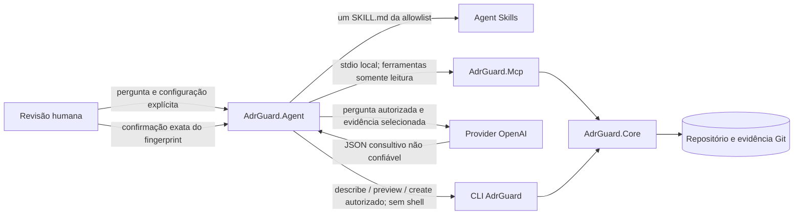

# Architecture Agent (somente desenvolvimento)

[English](architecture-agent.md) · [Visão geral do MCP](mcp.pt-BR.md) · [Modelo de segurança](mcp-security.pt-BR.md)

O projeto-fonte opcional `AdrGuard.Agent` contém fluxos somente leitura de perguntas arquiteturais e um fluxo supervisionado de criação de ADR. Essa é uma capacidade de desenvolvimento: nenhum pacote, manifesto de tool, instalador, contêiner ou release do Agent foi publicado. Compile e execute somente a partir deste repositório e não deduza disponibilidade a partir do projeto-fonte.

## Agent, MCP, CLI e Skills

Essas superfícies possuem autoridades e limites de distribuição diferentes:

| Superfície | Responsabilidade implementada | Autoridade e limite de escrita |
| --- | --- | --- |
| Architecture Agent | Selecionar um workflow controlado, reunir evidência, solicitar opcionalmente síntese consultiva do modelo e controlar uma criação supervisionada | Apenas orquestra; não aprova arquitetura nem escreve diretamente |
| Servidor MCP | Expor as sete ferramentas schema `1.0` de descoberta, validação, relações, impacto e drift por `stdio` local | Evidência estruturada somente leitura; não possui ferramentas de escrita |
| CLI | Ser proprietária da validação determinística e do contrato existente de renderização e persistência atômica de `new --form` | Único processo autorizado a criar a ADR `Proposed` supervisionada |
| Agent Skills | Fornecer orientação procedural versionada para onze workflows de ADR controlados por pessoas | Somente instruções; não são ferramentas executáveis, evidência nem aprovação |



`AdrGuard.Agent` não referencia Core, CLI ou MCP como assemblies. Ele se comunica com MCP e CLI somente por processos filhos limitados e contratos publicados. O provider nunca recebe ferramentas chamáveis e a pessoa continua sendo a única autoridade sobre a decisão.

## O que o primeiro fluxo faz

Para uma pergunta fornecida explicitamente, o executável:

1. seleciona um workflow controlado e sua única Agent Skill autorizada;
2. seleciona a operação mínima correspondente no catálogo fechado das sete ferramentas MCP do ADR Guard;
3. lê evidências versionadas no schema `1.0` por um processo MCP limitado a um repositório;
4. envia somente a pergunta, as instruções da skill selecionada e as evidências selecionadas ao provider de modelo configurado explicitamente;
5. valida uma resposta estruturada e limitada; e
6. apresenta o workflow e a proveniência MCP separadamente da interpretação consultiva, referências, trade-offs, incertezas e informações ausentes.

O seletor é determinístico e não usa function calling do modelo. Saída do modelo e conteúdo do repositório não podem adicionar ferramenta, comando ou operação de escrita. Workflows comuns de pergunta nunca invocam a CLI. O workflow de proposta usa somente as operações existentes `describe`, `preview` e, após autorização humana separada vinculada ao fingerprint, `create` de `adr-guard new --form` na CLI configurada explicitamente. Ele nunca invoca `draft`, altera ADR existente ou lifecycle, aprova decisão nem estabelece conformidade.

## Seleção controlada de workflow

O Agent reconhece cinco workflows somente leitura e mapeia cada um para uma skill de consumo existente sem copiá-la nem reescrevê-la:

| Intenção da pessoa usuária | Skill selecionada |
| --- | --- |
| Decidir se uma decisão deve ser registrada | `adr-guard-when-to-record` |
| Analisar alternativas e trade-offs | `adr-guard-tradeoff-analysis` |
| Consultar ou validar estruturalmente ADRs | `adr-guard-validate` |
| Fazer uma revisão técnica consultiva | `adr-guard-technical-review` |
| Preparar o esboço de uma ADR Proposed | `adr-guard-create` |

A allowlist cobre os onze artefatos versionados em `skills/adr-guard-*`, mas cada execução carrega somente o `SKILL.md` selecionado para sua pergunta. As outras seis skills permanecem disponíveis como encaminhamentos explícitos, em vez de serem combinadas silenciosamente no contexto do modelo. Os paths das instruções são fixos na allowlist, o nome no frontmatter deve corresponder e o tamanho das instruções participa do limite total de contexto. Instruções ausentes, divergentes ou excessivas produzem informação ausente explícita e nenhuma requisição ao modelo.

Skills fornecem apenas procedimentos. Resultados MCP continuam sendo a autoridade para evidências determinísticas de validação, impacto e drift; o modelo interpreta a evidência selecionada. Nenhuma dessas camadas aceita, rejeita ou aprova uma ADR. A preparação descobre campos e valida uma prévia somente leitura pela CLI. A persistência é uma ação humana separada e só pode criar uma nova ADR `Proposed`.

## Criação supervisionada de proposta de ADR

No workflow `adr-guard-create`, o Agent primeiro busca evidência de ADRs relacionados pelo MCP. Se nenhuma evidência relacionada estiver disponível, ele informa a incerteza e não chama o modelo nem a CLI. Caso contrário, ele:

1. chama `adr-guard new <diretório-de-adrs> --form` com a operação `describe` do schema `1.0`;
2. fornece ao modelo somente a skill selecionada, a evidência MCP e os IDs exatos de campos retornados pela CLI;
3. exige uma proposta limitada contendo título, esses campos exatos, alternativas, requisitos, riscos, referências de evidência, incertezas e informações ausentes;
4. fixa o status da proposta como `Proposed` no orquestrador; e
5. chama a operação `preview` do schema `1.0`, exibindo depois o Markdown renderizado pela CLI, destino provisório, executável, argumentos discretos, alvo, efeito esperado, riscos e fingerprint SHA-256 da proposta.

Configure o executável explicitamente com `--cli-command`; use valores repetíveis de `--cli-argument` quando o comando for um host como `dotnet` e limite cada operação com `--cli-timeout-seconds`. O processo filho usa argumentos discretos e não usa shell. Schema, tamanho da saída, exit status, lista de campos do template, `written: false` e path retornado são validados antes da exibição.

A prévia não persiste a proposta, atualiza índice, altera lifecycle nem reserva ID. A criação fica desabilitada sem `--enable-adr-creation` e uma CLI explícita. Em terminal interativo, a pessoa deve digitar independentemente `create <fingerprint>` depois de ver a prévia completa. Recusa, cancelamento, EOF, fingerprint incorreto ou entrada redirecionada/não interativa não iniciam o processo de criação. Flags de linha de comando isoladamente nunca autorizam uma proposta.

Após a autorização, o Agent não chama o modelo novamente. Ele repete `preview` com título e campos aprovados e rejeita mudança no Markdown antes da escrita. Depois envia schema `1.0`, `operation=create` e somente esses campos aprovados para a mesma fronteira `adr-guard new <diretório-de-adrs> --form`. A CLI preserva alocação atômica do ID e persistência sem sobrescrita; concorrência pode mudar o ID/path final, mas arquivos existentes permanecem intactos. O Agent valida `written: true`, contém o path no diretório de ADRs e verifica que o arquivo criado corresponde exatamente ao Markdown autorizado. Não há retry automático nem comando de aprovação, rejeição, supersession, edição ou mudança de lifecycle.

## Provider e credenciais atuais

O único provider real implementado é `openai`, adaptado por `Microsoft.Extensions.AI.IChatClient`. Provider e modelo não possuem defaults e devem ser selecionados juntos com `--provider openai --model <modelo>` quando houver síntese. Se ambos forem omitidos, o modo local somente leitura continua disponível e retorna evidência MCP sem chamada ao provider. A credencial da API é lida somente da variável de ambiente `OPENAI_API_KEY`; não existe opção de chave por linha de comando ou arquivo.

Se somente um entre provider/model for informado, ou se autorização explícita de contexto ou credencial de ambiente estiver ausente em um fluxo remoto, o processo falha com diagnóstico claro. Providers futuros permanecem atrás da porta interna `ILanguageModel` e exigem adaptador e revisão de política separados.

## Pré-requisitos e instalação local

- clone do repositório e SDK .NET fixado por `global.json` (`10.0.403` neste snapshot do código-fonte);
- executável `AdrGuard.Mcp` compilado localmente para todos os fluxos;
- CLI ADR Guard compilada localmente somente para preview de proposta ou criação supervisionada;
- conta OpenAI, modelo selecionado explicitamente e `OPENAI_API_KEY` somente quando a síntese remota estiver habilitada;
- terminal interativo para autorizar criação; entrada redirecionada não pode aprovar proposta;
- Git somente quando a evidência MCP selecionada de impacto ou drift exigir.

Não existe comando de instalação nem pacote publicado do Agent. Restaure e compile o checkout do código-fonte:

```bash
dotnet restore AdrGuard.slnx
dotnet build AdrGuard.slnx --configuration Release --no-restore
```

O executável de desenvolvimento resultante fica em `src/AdrGuard.Agent/bin/Release/net10.0/`. Os exemplos abaixo usam `dotnet run` para não sugerir instalação global.

## Exemplos de consulta arquitetural

O modo local somente leitura não exige credencial de provider nem CLI. Ele seleciona ferramentas MCP deterministicamente e apresenta a evidência estruturada sem síntese do modelo:

```bash
dotnet run --project src/AdrGuard.Agent/AdrGuard.Agent.csproj --configuration Release --no-build -- \
  --repository . \
  --adr-directory docs/adr \
  --mcp-command dotnet \
  --mcp-argument src/AdrGuard.Mcp/bin/Release/net10.0/adr-guard-mcp.dll \
  --question "Qual ADR define o limite de dependência do domínio?"
```

Para solicitar síntese consultiva, adicione provider, modelo, autorização explícita de contexto remoto e credencial somente por ambiente:

```bash
dotnet run --project src/AdrGuard.Agent/AdrGuard.Agent.csproj --configuration Release --no-build -- \
  --repository . \
  --adr-directory docs/adr \
  --mcp-command dotnet \
  --mcp-argument src/AdrGuard.Mcp/bin/Release/net10.0/adr-guard-mcp.dll \
  --provider openai \
  --model <id-explicito-do-modelo> \
  --question "Qual ADR define o limite de dependência do domínio e quais trade-offs ela registra?" \
  --allow-remote-context
```

Use as convenções de path do shell ativo e defina `OPENAI_API_KEY` pelo mecanismo de gestão de segredos do ambiente antes de iniciar o fluxo remoto.

## Exemplo de criação supervisionada

A criação também exige a CLI local, habilitação explícita da capacidade, evidência MCP relacionada e terminal interativo:

```bash
dotnet run --project src/AdrGuard.Agent/AdrGuard.Agent.csproj --configuration Release --no-build -- \
  --repository . \
  --adr-directory docs/adr \
  --mcp-command dotnet \
  --mcp-argument src/AdrGuard.Mcp/bin/Release/net10.0/adr-guard-mcp.dll \
  --cli-command dotnet \
  --cli-argument src/AdrGuard/bin/Release/net10.0/adr-guard.dll \
  --enable-adr-creation \
  --provider openai \
  --model <id-explicito-do-modelo> \
  --question "Preparar uma proposta de ADR para processamento assíncrono de pedidos" \
  --allow-remote-context
```

O Agent exibe preview completo e fingerprint antes do prompt. A criação começa somente se a pessoa digitar exatamente `create <fingerprint>`. O arquivo resultante permanece `Proposed`; a confirmação não aprova a decisão arquitetural.

## Autorização de contexto e privacidade

`--allow-remote-context` autoriza a transmissão de três classes de dados nesta invocação: o texto da pergunta, o único arquivo de skill versionado selecionado e os payloads estruturados completos retornados pelas ferramentas MCP selecionadas. Esses payloads podem conter conteúdo e títulos de ADRs, paths relativos ao repositório, diagnósticos, mapeamentos, regras e evidências limitadas. Não use a flag sem confirmar que esse material pode ser enviado ao provider selecionado conforme a política de retenção, residência e privacidade da organização.

O Agent não segue links das skills nem carrega arquivos referenciados e não transmite variáveis de ambiente, chave da API, arquivos arbitrários, outros arquivos de skill ou resultados MCP não selecionados. Ele não registra a credencial nem a resposta integral do provider. Conteúdo MCP permanece marcado como não confiável no prompt e o modelo não recebe ferramentas chamáveis.

## Limites configuráveis

| Opção | Default | Limite aplicado |
| --- | ---: | --- |
| `--max-iterations` | `1` | Máximo de iterações do provider; o primeiro fluxo usa exatamente uma iteração de síntese |
| `--max-context-characters` | `65536` | Pergunta, proveniência e payloads MCP selecionados; excesso falha fechado sem truncar evidência |
| `--max-output-tokens` | `2048` | Orçamento de saída enviado ao provider por `Microsoft.Extensions.AI` |
| `--max-duration-seconds` | `120` | Duração total de conexão MCP, ferramentas e provider |
| `--max-tool-calls` | `4` | Chamadas MCP selecionadas antes da execução de qualquer chamada |
| `--mcp-timeout-seconds` | `30` | Inicialização MCP e cada operação de ferramenta |
| `--cli-timeout-seconds` | `30` | Cada operação opcional `describe`, `preview` ou `create` autorizada do processo `new --form` |
| `--search-limit` | `20` | Quantidade limitada de resultados de `search_adrs` |

Valores fora dos intervalos documentados são rejeitados como erro de uso. O cliente MCP rejeita independentemente respostas excessivas, formas malformadas, campos desconhecidos e schemas diferentes de `1.0`.

## Seleção de evidência e entradas ausentes

Perguntas arquiteturais gerais usam busca limitada de ADRs. Linguagem explícita sobre listagem, identificador de ADR, relacionamentos, validação, impacto e drift seleciona somente a operação de leitura correspondente. Impacto exige `--impact-manifest` e aceita `--impact-base-reference`; drift exige `--architecture-rules` e aceita as entradas existentes `--architecture-evidence`, `--architecture-baseline` e `--architecture-policy`.

Quando uma entrada explícita obrigatória está ausente, o Agent informa a lacuna e não chama MCP nem provider para aquele ramo sem suporte. Evidência `unknown` ou inconclusiva, findings determinísticos, erros operacionais e cancelamento permanecem visíveis e nunca são convertidos em sucesso.

## Limite de confiança da saída

A lista de evidências mostra nome da ferramenta, argumentos, schema e status. A seção do modelo é sempre identificada como interpretação consultiva não confiável. A resposta JSON deve ter exatamente a forma esperada e só pode referenciar IDs de evidência realmente emitidos pelo orquestrador; saída malformada ou ID inventado falha de forma fechada.

Validar a referência comprova o vínculo de proveniência, não que a prosa do modelo esteja correta. Uma pessoa deve comparar afirmações e trade-offs com a evidência MCP citada e com as ADRs antes de tomar qualquer decisão arquitetural.

## Testes

Os testes automatizados do Agent usam modelo fake e respostas MCP controladas. Eles não exigem `OPENAI_API_KEY`, não contatam a OpenAI e não consomem tokens externos. A integração de processo usa os executáveis locais MCP e CLI com repositórios temporários. Testes de proposta cobrem recusa, cancelamento, fingerprint incorreto, rejeição não interativa, entrada inválida ou alterada, criação `Proposed` bem-sucedida, alocação atômica concorrente, ausência de sobrescrita e falhas seguras da CLI.

## Limites de autonomia, segurança, privacidade e custos

- O Agent não pode aceitar, rejeitar, substituir nem aprovar uma ADR; dispensar política; declarar conformidade; editar ADR existente; ou executar comandos descobertos no conteúdo do repositório.
- MCP e fluxos comuns de pergunta são somente leitura. A única mutação implementada é uma nova ADR `Proposed` pela CLI configurada depois da confirmação interativa do fingerprint exato.
- ADRs, instruções de skill, payloads MCP e saída do modelo são não confiáveis. A seleção de ferramentas ocorre antes do modelo, schema/campos desconhecidos falham fechados e processos filhos usam argumentos discretos, timeout, saída limitada, nenhum shell e uma allowlist de ambiente sem credenciais.
- O modo local somente leitura não envia dados a modelo e não gera custo de tokens do provider. O modo remoto envia pergunta, instruções da skill selecionada e payloads MCP completos selecionados; preços, retenção, residência, rate limits e custos de rede do provider são responsabilidades externas.
- `--max-output-tokens` limita a saída solicitada, não a cobrança completa do provider. O contexto de entrada normalmente também é cobrado. Use perguntas estreitas, entradas explícitas de ferramentas e o orçamento padrão de uma iteração; o Agent não faz retry automático do modelo nem de escrita.
- A implementação no código-fonte ainda não persiste trilha de auditoria sanitizada. A saída do terminal é revisável, mas equipes que precisam de registros duráveis de aprovação devem capturá-los fora do Agent sem registrar segredos nem payloads sensíveis completos.

## Solução de problemas

| Sintoma | Causa provável | Ação segura |
| --- | --- | --- |
| `does not expose the required read-only tool catalog` | Versão ou executável MCP incompatível | Compile o MCP no mesmo checkout ou verifique um servidor schema `1.0` com as sete ferramentas |
| `Remote context sharing is disabled` | Provider/model configurados sem consentimento explícito | Revise as classes de dados acima e adicione `--allow-remote-context` somente se a política permitir |
| `OPENAI_API_KEY` ausente | Síntese remota habilitada sem credencial de ambiente | Defina o segredo no ambiente de inicialização ou omita provider/model para evidência local somente leitura |
| Nenhuma requisição ao modelo | Entrada obrigatória de impacto/drift, evidência de ADR relacionada ou instrução autorizada da skill ausente | Forneça a entrada explícita relativa ao repositório ou examine a seção de informação ausente |
| A proposta aparece, mas nenhum arquivo é criado | Criação desabilitada, entrada não interativa ou confirmação divergente | Adicione configuração explícita da CLI e `--enable-adr-creation`, use terminal interativo e digite o fingerprint atual exato somente após revisar |
| `CLI invocation changed` ou preview alterado | Alvo, argumentos, timeout, campos ou Markdown renderizado não correspondem mais à proposta autorizada | Inicie nova execução e revise novo fingerprint; nunca reutilize a aprovação antiga |
| Timeout ou saída excessiva de MCP/CLI | Processo filho excedeu os limites configurados | Investigue o executável local e restrinja a evidência; aumente limite somente após revisar confiança e custo |
| Path retornado é rejeitado | Resultado da CLI escapou do repositório/diretório de ADRs ou usou forma sem suporte | Trate como falha operacional/de segurança; não mova nem crie o arquivo manualmente pelo Agent |

## Estado de distribuição

Estado verificado em 13/11/2026: `AdrGuard.Agent` está disponível somente no código-fonte e somente para desenvolvimento. A busca exata no NuGet.org por `RodriOliveira.AdrGuard.Agent` não retornou pacote, e este repositório não contém baseline de pacote, instalador, contêiner, manifesto de tool, tag de release nem canal suportado de instalação limpa do Agent. CLI e MCP possuem linhas de publicação independentes; instalar qualquer um deles não instala o Agent.

Compile a partir de um checkout confiável apenas para avaliação. Não documente `dotnet tool install`, pull de contêiner, Package ID nem suporte de produção para o Agent até implementar e verificar versão independente, conteúdo de pacote, SBOM/gates de segurança, workflow de release e canal público. Presença no código-fonte e testes aprovados não comprovam publicação.
