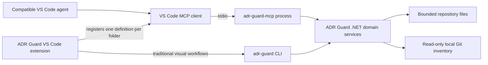

# ADR Guard MCP server

[Português (Brasil)](mcp.pt-BR.md)

The ADR Guard MCP server is a local, read-only adapter that exposes ADR Guard domain capabilities to Model Context Protocol clients. It lets a compatible agent list, read, search, relate, validate, and analyze ADRs without replacing the CLI or embedding an AI model in ADR Guard.

> **Availability:** MCP `1.0.0` is published on [NuGet.org](https://www.nuget.org/packages/RodriOliveira.AdrGuard.Mcp/1.0.0), [GitHub Releases](https://github.com/rodri-oliveira-dev/adr-guard/releases/tag/mcp/v1.0.0), and the official MCP Registry. GitHub Packages is an authenticated secondary feed with an independently triggered backfill for the already published 1.0.0 release. See [MCP release distribution](mcp-release.md).

The prepared Registry name is `io.github.rodri-oliveira-dev/adr-guard`, backed by the NuGet package `RodriOliveira.AdrGuard.Mcp`. The Registry is discovery metadata for compatible clients; it does not guarantee client-side automatic installation. The only transport is local `stdio`.

## Architecture

The MCP process and CLI are separate executables over the same .NET domain implementation. The extension's visual commands continue to invoke `adr-guard` directly. MCP registration is optional and only lets VS Code manage an independent `adr-guard-mcp` process for a selected workspace folder.

ADR Guard supplies structured tools and evidence. The client agent performs natural-language interpretation. Neither the server nor an agent can approve an ADR, establish architectural compliance beyond the declared deterministic rules, or change lifecycle status.

## Runtime model

- Transport: `stdio` only. Standard output is reserved for protocol messages; diagnostics go to standard error.
- Scope: one repository root and one ADR directory are fixed when the process starts.
- Operations: all seven tools are declared read-only, non-destructive, idempotent, and closed-world.
- Configuration: `.adrguard.yml` is read from the selected repository when present. An explicit `--adr-directory` overrides its ADR directory.
- Limits: operations default to 30 seconds, accept a configured limit from 1 to 300 seconds, return at most 1 MiB, enumerate at most 1,000 ADRs, and read at most 512 KiB per ADR.
- Protocol data: tool contracts currently use schema version `1.0`. Markdown content and excerpts are explicitly marked untrusted.

## Start here

1. Follow [local build and client configuration](mcp-configuration.md).
2. Review the [available tool contracts](mcp-tools.md).
3. Apply the [security and permission model](mcp-security.md).
4. For VS Code integration details and the independent visual workflows, see the [extension guide](../extensions/vscode/README.md).

Related deterministic capabilities remain documented in [Architecture Impact Analysis](guides/architecture-impact-analysis.md), [Architectural Drift](guides/architectural-drift.md), and the [CLI reference](cli-reference.md).

## Limitations

- There is no network transport, remote hosted service, write tool, resource, prompt, or autonomous agent in this implementation.
- The server does not install itself, fetch Git references, run builds/tests/scripts, generate baselines, create ADRs, or update indexes.
- The public .NET 10 MCP tool can be installed from NuGet.org with `dotnet tool install --global RodriOliveira.AdrGuard.Mcp --version 1.0.0`; GitHub Packages requires authenticated feed access after its backfill has completed. Source builds remain available.
- Client compatibility is documented only where the repository has a concrete integration: the VS Code stable MCP extension API. Other clients may work with a standard `stdio` command but are not claimed as tested here.
