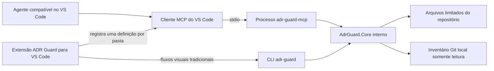

# Servidor MCP do ADR Guard

[English](mcp.md)

O servidor MCP do ADR Guard é um adaptador local e somente leitura que expõe capacidades de domínio do ADR Guard a clientes do Model Context Protocol. Ele permite que um agente compatível liste, leia, pesquise, relacione, valide e analise ADRs sem substituir a CLI nem incorporar um modelo de IA ao ADR Guard.

> **Disponibilidade:** o MCP `1.0.0` está publicado no [NuGet.org](https://www.nuget.org/packages/RodriOliveira.AdrGuard.Mcp/1.0.0), em [GitHub Releases](https://github.com/rodri-oliveira-dev/adr-guard/releases/tag/mcp/v1.0.0) e no MCP Registry oficial. MCP `1.0.1` é uma candidata não publicada; não use sua versão em comandos públicos de instalação até verificar NuGet.org e Registry. GitHub Packages é um feed secundário autenticado, com backfill independente para a versão 1.0.0 já publicada. Veja [distribuição do MCP](mcp-release.pt-BR.md).

O nome preparado no Registry é `io.github.rodri-oliveira-dev/adr-guard`, associado ao pacote NuGet `RodriOliveira.AdrGuard.Mcp`. O Registry fornece metadados de descoberta para clientes compatíveis; ele não garante instalação automática pelo cliente. O único transporte é `stdio` local.

## Arquitetura

O processo MCP e a CLI são executáveis separados que referenciam diretamente a mesma implementação interna e não empacotável `AdrGuard.Core`. Pacotes candidatos MCP contêm MCP mais Core e excluem o executável da CLI; pacotes candidatos da CLI contêm CLI mais Core e excluem MCP. Core não tem pacote nem linha de release. Os comandos visuais da extensão continuam invocando `adr-guard` diretamente. O registro MCP é opcional e apenas permite que o VS Code gerencie um processo `adr-guard-mcp` independente para a pasta selecionada do workspace.

O ADR Guard fornece ferramentas estruturadas e evidências. O agente cliente realiza a interpretação em linguagem natural. Nem o servidor nem um agente podem aprovar uma ADR, estabelecer conformidade arquitetural além das regras determinísticas declaradas ou alterar o status do ciclo de vida.

## Modelo de execução

- Transporte: somente `stdio`. A saída padrão é reservada às mensagens do protocolo; diagnósticos usam a saída de erro.
- Escopo: uma raiz de repositório e um diretório de ADRs são fixados na inicialização do processo.
- Operações: as sete ferramentas são declaradas somente leitura, não destrutivas, idempotentes e sem acesso aberto ao mundo externo.
- Configuração: `.adrguard.yml` é lido no repositório selecionado quando existe. Um `--adr-directory` explícito substitui o diretório de ADRs configurado.
- Limites: operações usam 30 segundos por padrão, aceitam limite configurado entre 1 e 300 segundos, retornam no máximo 1 MiB, enumeram no máximo 1.000 ADRs e leem no máximo 512 KiB por ADR.
- Dados de protocolo: os contratos das ferramentas usam atualmente o schema `1.0`. Conteúdo Markdown e trechos são marcados explicitamente como não confiáveis.

## Comece aqui

1. Siga a [compilação local e configuração de clientes](mcp-configuration.pt-BR.md).
2. Consulte os [contratos das ferramentas disponíveis](mcp-tools.pt-BR.md).
3. Aplique o [modelo de segurança e permissões](mcp-security.pt-BR.md).
4. Para integração com VS Code e os fluxos visuais independentes, consulte o [guia da extensão](../extensions/vscode/README.pt-BR.md).

As capacidades determinísticas relacionadas continuam documentadas em [Análise de Impacto Arquitetural](guides/architecture-impact-analysis.pt-BR.md), [Drift Arquitetural](guides/architectural-drift.pt-BR.md) e na [referência da CLI](cli-reference.pt-BR.md).

## Limitações

- Esta implementação não possui transporte de rede, serviço remoto hospedado, ferramenta de escrita, resource, prompt ou agente autônomo.
- O servidor não instala a si próprio, não busca refs Git, não executa builds/testes/scripts, não gera baselines, não cria ADRs nem atualiza índices.
- A .NET Tool MCP pública para .NET 10 pode ser instalada pelo NuGet.org com `dotnet tool install --global RodriOliveira.AdrGuard.Mcp --version 1.0.0`; o GitHub Packages exige autenticação após a conclusão do backfill. A compilação pelo código-fonte permanece disponível.
- A compatibilidade com clientes é documentada apenas onde há integração concreta no repositório: a API estável de MCP para extensões do VS Code. Outros clientes podem funcionar com um comando `stdio` padrão, mas não são apresentados aqui como testados.
