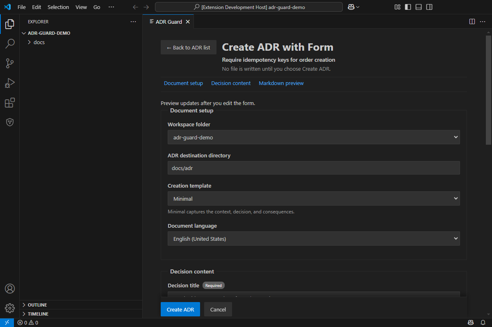
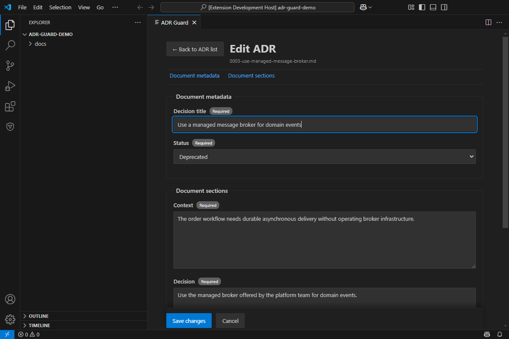
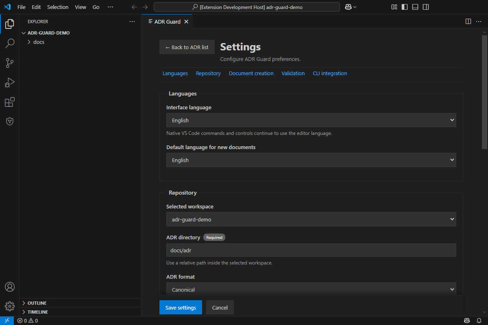

# ADR Guard for VS Code

ADR Guard for VS Code is a workspace extension that presents the existing ADR Guard CLI inside the editor. It provides native commands, Problems diagnostics, and a dedicated Activity Bar container with the ADR Explorer while leaving parsing, validation, policy, generation, and Git-aware analysis in the .NET CLI.

> **Published:** [ADR Guard for VS Code 0.1.1](https://marketplace.visualstudio.com/items?itemName=rodrioliveira.adr-guard) is available on the Visual Studio Marketplace as `rodrioliveira.adr-guard`. The compatible ADR Guard CLI contracts were published in NuGet **v1.3.0** (including the former v1.4 development scope). The VS Code extension and .NET CLI are distributed and versioned separately; the extension does not bundle the CLI.

## Features

- Check that the CLI is discoverable in the workspace extension host.
- Initialize an ADR repository through a dry-run preview and explicit confirmation.
- Create ADRs with the CLI's configured, minimal, extended, or workspace-local custom template.
- Create ADRs through a guided visual form with a Markdown source preview when the configured template is native.
- Browse, search, filter, sort, and open ADRs from the visual ADR Guard home screen.
- Validate ADRs and publish versioned JSON findings in the VS Code Problems panel.
- Opt in to debounced validation after saving an ADR.
- Generate an ADR index only after explicit confirmation.
- Browse canonical and MADR 4.0 files in the native Explorer, including safe display-only status and relationship navigation.
- Run Git-aware changed-file validation against an explicit local base ref, with no hidden fetch.
- Classify diagnostics against an existing read-only baseline.
- Use English UI by default and Brazilian Portuguese when VS Code uses `pt-BR`.

## Interface preview (unreleased)

The images below document the extension 1.0.0 development branch in a real Extension Development Host with a CLI built from the same branch. They document development-branch behavior, not the currently published 0.1.1 Marketplace package. Visual creation and editing require the CLI 1.7.0 schema `1.0` form contracts.

### Browse and search


### Create with a native template



### Edit a supported ADR



### Configure the extension



The portal's [VS Code Visual Guide](https://rodri-oliveira-dev.github.io/adr-guard/product/vscode-visual-guide/) covers the Explorer, filters, Minimal and Extended creation, Markdown preview, external-change-safe editing, validation settings, CLI integration, and Problems diagnostics.

## Requirements and installation

- VS Code `1.100.0` or newer in the `1.x` line.
- A trusted local `file:` workspace.
- A compatible `adr-guard` executable installed in the environment where the **workspace extension host** runs.

Install the compatible CLI (v1.3.0 or newer) in the local or remote workspace extension host environment:

```shell
dotnet tool install --global RodriOliveira.AdrGuard
adr-guard --version
```

For development capabilities that are not released yet, build or install the CLI from the corresponding repository branch and set `adrGuard.cli.path` to its trusted absolute executable path. Otherwise the extension searches absolute directories on the extension host `PATH`. It never downloads or installs the CLI.

Install the published extension from the VS Code **Extensions** view (search **ADR Guard**) or run:

```shell
code --install-extension rodrioliveira.adr-guard
```

For manual testing of a locally generated VSIX, use **Extensions: Install from VSIX...** and select `adr-guard-1.0.0.vsix`. This is separate from installation through the Marketplace.

## Commands

Open the Command Palette and choose the command under **ADR Guard**:

| Command | Behavior |
| --- | --- |
| Check Installation | Runs `adr-guard --version` using safe discovery. |
| Initialize Repository | Previews `init --dry-run`, then asks before writing. Existing files are not overwritten. |
| Create ADR | Runs the compatible traditional `new` flow and opens the verified created file. |
| Open ADR Guard | Opens or reveals the visual ADR list without creating files or running validation. |
| Create ADR with Form | Opens the guided form, previews through the CLI, then creates only after explicit submission. |
| Validate ADRs | Runs a full JSON validation and updates Problems. |
| Validate Changed ADRs | Uses `--changed --base-ref`; it never performs `git fetch`. |
| Validate ADRs with Baseline | Reads the configured existing baseline and reports new/existing/resolved counts. |
| Generate ADR Index | Warns before the CLI can update the ADR `README.md`. |
| Select ADR Format | Selects `canonical` or `madr-4` for the workspace folder. |
| Refresh ADR Explorer | Invalidates the Explorer cache and reloads it. |
| Reveal Current ADR | Selects the active ADR in the Explorer. |

Multi-root workspaces are supported. Commands use the active file's folder when possible and otherwise ask which folder to use. Settings with resource scope can differ by workspace folder.

## Visual ADR list (unreleased)

Run **ADR Guard: Open ADR Guard** from the Command Palette or the ADR Explorer title. The reusable visual panel starts on the selected workspace folder's configured ADR directory and shows available identifier, title, status, date, and relative path metadata. Search is case-insensitive across title, identifier, and path; status filters and deterministic number/title/date ordering run locally without invoking full CLI validation. Missing metadata remains visibly unknown and unnumbered records sort after numbered ADRs.

Clicking the dedicated ADR Guard icon in the Activity Bar also opens or reveals this visual list. The same panel is reused, so repeated clicks do not create duplicate tabs.

The list header groups refresh, installation check, repository initialization, creation, and a settings gear. Initialization is available only while the configured directory has no ADRs; once ADRs exist, the disabled control explains that the repository is already initialized.

The list distinguishes loading, empty, filtered-empty, missing-directory, unavailable-workspace, and read-error states. It never creates a directory or initializes a repository while browsing. File changes are batched by the shared ADR Explorer watcher, and switching workspace folders cannot allow an older response to replace the current folder.

**New ADR** opens the existing form in the same panel and keeps the folder, directory, search, filter, order, and scroll state for the return. Successful creation returns to the refreshed list, highlights the new ADR, refreshes the native Explorer, and offers **Open Markdown** without taking focus away automatically. If current filters hide the new record, the panel says so and offers an explicit reveal action. Cancel and **Back to ADR list** return without writing; leaving a dirty form through these controlled actions requires confirmation. The direct **Create ADR with Form** command remains available and returns to the list as well.

Back and Cancel are navigation-only actions in creation, editing, and settings. They never invoke `new`, `edit --save`, `check`, or `index`; while a create, edit, or settings save is active, those controls remain disabled to prevent a competing transition. Refresh, search, filters, sorting, workspace selection, and Explorer file watchers likewise refresh read-only catalog state without starting ADR validation.

Each list item also provides **Edit**. The same visual panel loads the selected canonical or MADR 4.0 document through the CLI's schema `1.0` `edit --form` contract, exposes its supported title, status, metadata, and level-two sections, and returns to the preserved list after saving or cancelling. The CLI performs format-aware validation and localized Markdown replacement, keeps the path and identifier unchanged, preserves untouched metadata/sections/spacing, and rejects a save when the file fingerprint changed after loading. The extension revalidates workspace and catalog boundaries before every load or save.

## Visual ADR creation form (unreleased)

Run **ADR Guard: Create ADR with Form** from the Command Palette or use the new-file action in the ADR Explorer title. The form keeps workspace folder and document language separate from the VS Code interface language, initializes the destination from `adrGuard.validation.directory`, uses the folder's default document language and creation template, and still permits per-document changes.

The form supports the native `minimal` and `extended` creation templates. Minimal requires Context, Decision, and Consequences. Extended exposes those required fields plus optional Decision Drivers, Options Considered, Rationale, Positive/Negative Consequences, Risks, and References; optional empty sections are omitted. Creation remains canonical—the `canonical`/`madr-4` validation format setting is a separate concern and is not presented as a creation-template choice.

Configured custom templates cannot be mapped to fields safely. The form reports that limitation and offers **Use traditional creation** without replacing the custom template. The traditional **Create ADR** command remains available for all supported custom templates and older CLIs.

Visual creation requires CLI 1.7.0 or newer with the schema `1.0` `new --form` contract. Preview and creation use the same CLI renderer; preview does not write, reserve a number, or update the index, while creation resolves the final number atomically and never overwrites an existing file. Form state remains in the retained panel while it is hidden. VS Code does not provide a cancellable WebviewPanel close event, so closing the panel cannot show a guaranteed unsaved-changes confirmation and discards its in-memory state.

## Visual settings (unreleased)

Use the list header's settings gear to configure the existing panel without opening another tab. Interface language is stored in user settings as Automatic (VS Code), Portuguese (Brazil), or English. Automatic follows the editor locale for ADR Guard Webview text only; native VS Code commands and controls keep the editor's own locale. Default document language and creation template are independent workspace-folder settings, so multi-root folders may differ.

The Repository section reuses `adrGuard.validation.directory` and `adrGuard.validation.adrFormat`. The directory must be a safe relative path whose existing path ancestry stays within the selected workspace. Saving preferences does not create, move, delete, validate, or index ADR files. Back and Cancel preserve the list state and require confirmation before discarding changed settings.

Settings are committed through the VS Code configuration API at their documented user/machine or workspace-folder scopes. If one write in the group fails, already applied writes are rolled back and the draft remains available for retry; the panel reports the operation as failed rather than presenting partial persistence as success.

The Validation section configures opt-in validation on save, its 200-5000 ms debounce, the read-only baseline path, and the default local Git reference suggested by incremental validation. Turning save validation off preserves the debounce value. The incremental command still lets you edit the reference before execution and never runs `git fetch`. A settings change only updates VS Code preferences; validation runs later only for an applicable file-save event or an explicit validation command.

The CLI Integration section exposes the machine-scoped executable, timeout, and output limit. An empty executable uses secure discovery on the extension host `PATH`; configured values must be absolute local paths and continue through the existing executable validation. Timeout and output limits remain inside the collapsible advanced section. **Check installation** is always explicit, uses the last saved CLI settings, and reports the detected version or actionable failure without installing or updating anything.

## ADR Explorer and formats

The **Architecture Decision Records** view appears in the built-in Explorer. It scans the configured ADR directory, ignores its generated `README.md`, and displays a bounded subset of title, status, and recognized Markdown relationships. Those fields are navigation metadata only; the CLI remains authoritative for canonical and MADR 4.0 structure and governance.

Relationship targets must resolve to regular Markdown files within the selected workspace and ADR directory. Ambiguous, missing, external, virtual, or symlink-escaping targets are not opened.

## Diagnostics, save validation, and baseline

`Validate ADRs` maps schema `1.0` CLI JSON findings to Problems. Because that schema does not define line and column positions, diagnostics navigate to `(0, 0)` without claiming an exact source location. Malformed JSON, incompatible schemas, contradictory exit codes, files outside the ADR directory, and CLI exits `2`–`4` are operational failures rather than clean results.

`adrGuard.validation.onSave` defaults to `false`. When enabled, only saved Markdown ADRs below the configured directory trigger validation; save bursts are debounced, older runs are cancelled, and stale results cannot replace newer diagnostics. Save validation never creates ADRs, generates an index, runs AI, fetches Git refs, or writes a baseline.

Baseline validation uses the existing `adrGuard.validation.baseline` JSON file read-only. Creating or updating a baseline remains an explicit CLI workflow outside this MVP.

## Workspace Trust, remote environments, and security

The extension declares untrusted and virtual workspaces unsupported. It does not execute a process until the workspace is trusted and the selected folder resolves to a local `file:` path. The configured executable setting has machine scope; PATH candidates controlled by an open workspace are rejected. CLI arguments are passed as a literal array with `shell: false`, and execution has cancellation, timeout, and independent stdout/stderr limits.

In WSL, Remote-SSH, and Dev Containers the workspace extension runs remotely. Install the CLI and configure its path **inside that remote environment**, not only on the local UI machine. Pure VS Code Web and virtual workspaces without a Node workspace extension host and local filesystem are not supported.

ADR Guard for VS Code does not collect telemetry, install software, access AI provider credentials, invoke AI automatically, modify ADRs on save, write baselines automatically, or run hidden network/Git fetch operations. Explicit `init`, `new`, and `index` commands can write files as described above.

## Settings

- `adrGuard.cli.path`: trusted absolute CLI path in user/machine settings.
- `adrGuard.cli.timeoutMilliseconds`: process timeout, 1–120 seconds.
- `adrGuard.cli.maxOutputBytes`: separate stdout/stderr capture limit.
- `adrGuard.ui.language`: user-level ADR Guard Webview language (`auto`, `pt-BR`, or `en-US`).
- `adrGuard.creation.documentLanguage`: workspace-folder default language for new ADRs.
- `adrGuard.creation.defaultTemplate`: workspace-folder creation default (`configured`, `minimal`, or `extended`).
- `adrGuard.validation.directory`: workspace-relative ADR directory.
- `adrGuard.validation.adrFormat`: `canonical` or `madr-4`.
- `adrGuard.validation.baseline`: workspace-relative baseline JSON path.
- `adrGuard.validation.onSave`: opt-in save validation.
- `adrGuard.validation.debounceMilliseconds`: save debounce interval.
- `adrGuard.validation.baseReference`: workspace-folder default suggested by incremental validation (`main` by default).

## Troubleshooting

- **CLI not found:** run **Check Installation** and verify `adr-guard --version` in the same local or remote environment as the workspace. Set an absolute `adrGuard.cli.path` if needed.
- **Visual form unavailable:** install CLI 1.7.0 or a development build containing `new --form`, or choose **Use traditional creation**. The extension detects support from the command contract instead of trusting a version string.
- **Unsupported option / exit code 2:** the installed CLI is older than the requested MADR, changed-validation, or baseline contract. Install a compatible CLI or use full canonical validation.
- **Workspace disabled:** trust the workspace and use a local `file:` folder. Virtual workspaces and pure browser hosts are intentionally unsupported.
- **Timeout/output limit:** raise the bounded machine setting only when the repository legitimately requires it.
- **No exact diagnostic line:** JSON schema `1.0` supplies a file but no source range; open the diagnostic and inspect the named ADR rule.
- **Remote CLI mismatch:** install/configure the CLI on the remote extension host.

For reproducible bugs and support, use the [GitHub issue tracker](https://github.com/rodri-oliveira-dev/adr-guard/issues). Security reports follow the repository's [security policy](https://github.com/rodri-oliveira-dev/adr-guard/blob/main/SECURITY.md), and contributions follow the [repository guidance](https://github.com/rodri-oliveira-dev/adr-guard). The extension is licensed under the [MIT License](LICENSE). Portuguese documentation is available in [README.pt-BR.md](README.pt-BR.md).
