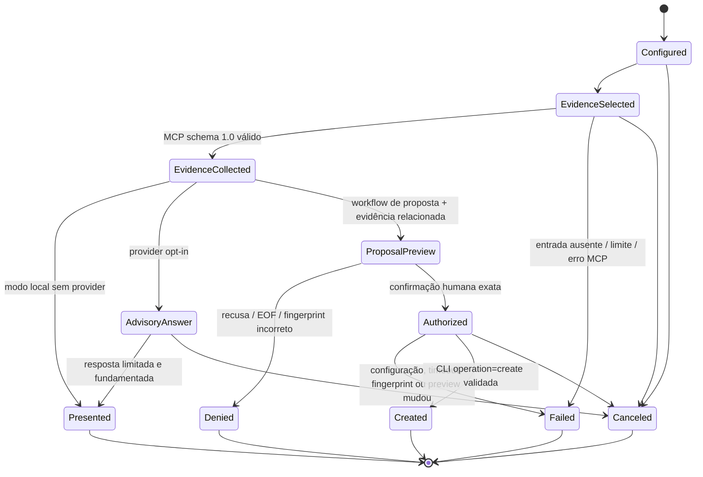
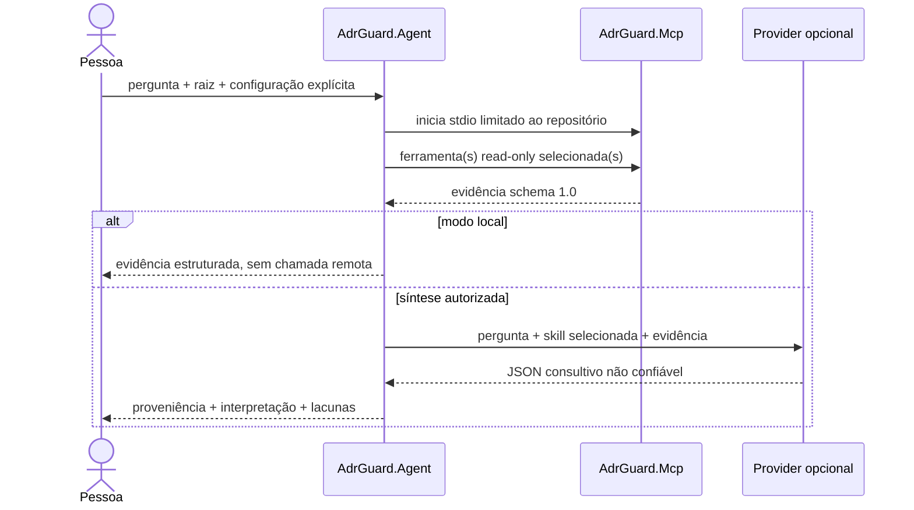

# Plano: Architecture Agent

## Direção arquitetural

O código-fonte atual contém o executável .NET opcional `AdrGuard.Agent`. Ele atua como cliente de processos: lê exclusivamente pelo `adr-guard-mcp` existente e escreve exclusivamente pelo `adr-guard` existente após aprovação humana. O agente não referencia `AdrGuard.Core` nem os projetos executáveis e não adiciona contratos a eles. Versionamento e distribuição independentes ainda não foram definidos.

## Estado da implementação

| Fase | Estado validado | Pendência principal |
| --- | --- | --- |
| 0 — contratos e ameaças | Limites, allowlist, provider, dados e compatibilidade registrados | ADR 0009 continua `Proposed` até revisão humana |
| 1 — leitura local | Sete ferramentas MCP schema `1.0`, isolamento e modo sem provider implementados | Validação multiplataforma completa |
| 2 — conselho remoto | OpenAI opt-in, contexto explícito, resposta limitada e sem tool calling implementados | Política externa de retenção/residência depende da organização/provider |
| 3 — proposta/aprovação | Preview, fingerprint, recusa/cancelamento e invalidação material implementados | Trilha persistente sanitizada e fluxo de edição não existem |
| 4 — escrita mínima | Somente criação `Proposed` pela CLI, repreview e no-overwrite implementados | Exercitar códigos CLI forçados `1`, `3` e `4`; releitura MCP pós-falha ambígua |
| 5 — documentação/distribuição | Documentação bilíngue e portal preparados para estado source-only | Pacote, SBOM, canais, instalação limpa e publicação não existem |

## Componentes propostos

| Componente | Responsabilidade | Não pode fazer |
| --- | --- | --- |
| Modelo de sessão | Representar intenção, evidência, hipóteses, propostas, aprovações e resultados | Conter regras de validação de ADR ou aceitar saída do modelo como fato |
| Orquestrador | Conduzir estados e políticas, limitar contexto e exigir aprovação | Aprovar decisões, escrever arquivos diretamente ou ignorar falhas |
| Adaptador de modelo | Traduzir contexto autorizado em uma solicitação e devolver conselho não confiável | Chamar ferramentas, escolher aprovação ou declarar compliance |
| Cliente MCP | Iniciar/encerrar `adr-guard-mcp`, negociar schema e validar respostas | Escrever, ampliar a raiz ou reinterpretar regras de domínio |
| Catálogo de ferramentas | Mapear intenções permitidas às sete ferramentas existentes e registrar proveniência | Criar ferramentas implícitas ou executar conteúdo do workspace |
| Gate de aprovação | Vincular uma decisão humana a uma proposta imutável e atual | Reutilizar aprovação após qualquer alteração material |
| Adaptador CLI | Invocar uma allowlist de comandos existentes com argumentos discretos | Usar shell, montar comando a partir de Markdown ou contornar validação da CLI |
| Apresentação | Separar evidência, interpretação, incerteza, proposta e resultado | Ocultar origem, limites ou efeitos da ação |

## Máquina de estados implementada



## Fluxo de leitura

1. A pessoa seleciona um repositório e habilita explicitamente o agente.
2. O orquestrador valida configuração local e inicia um MCP limitado à raiz.
3. A intenção é mapeada para uma ou mais das sete ferramentas permitidas.
4. O cliente MCP valida envelope, versão e limites da resposta.
5. A evidência é armazenada separadamente do conteúdo não confiável.
6. Se habilitado, o adaptador envia ao modelo apenas o contexto autorizado.
7. A apresentação distingue fatos, interpretação, lacunas e próximos passos.



## Fluxo de escrita

1. O modelo ou a pessoa sugere uma ação; isso ainda não tem efeito.
2. O orquestrador cria uma proposta canônica com ID, alvo, conteúdo, comando/argumentos permitidos, riscos e fingerprint quando disponível.
3. A apresentação mostra diff/preview e efeito esperado usando recursos existentes da CLI quando aplicáveis.
4. A pessoa aprova ou recusa a proposta exata.
5. O gate revalida identidade, configuração, alvo e fingerprint imediatamente antes da execução.
6. O adaptador inicia a CLI sem shell e respeita timeout/cancelamento.
7. O resultado real e o exit code são registrados e apresentados; falha não causa retry de escrita automático.
8. Nova leitura pelo MCP pode confirmar o estado observado, sem transformar essa confirmação em aprovação arquitetural.

```mermaid
sequenceDiagram
    actor Pessoa
    participant Agent as AdrGuard.Agent
    participant MCP as AdrGuard.Mcp
    participant Modelo as Provider
    participant CLI as AdrGuard CLI
    Agent->>MCP: busca ADRs relacionados
    MCP-->>Agent: evidência read-only
    Agent->>CLI: new --form / describe
    CLI-->>Agent: template schema 1.0
    Agent->>Modelo: contexto autorizado + campos exatos
    Modelo-->>Agent: proposta estruturada não confiável
    Agent->>CLI: new --form / preview
    CLI-->>Agent: Markdown + destino provisório
    Agent-->>Pessoa: preview + efeitos + riscos + fingerprint
    Pessoa->>Agent: create <fingerprint>
    Agent->>CLI: repreview; depois operation=create
    CLI-->>Agent: written:true + path
    Agent-->>Pessoa: resultado real; status continua Proposed
```

## Estratégia de compatibilidade

- Consumir MCP schema `1.0` e apenas ferramentas existentes.
- Usar somente comandos e exit codes já publicados da CLI.
- Rejeitar versões desconhecidas e formas inesperadas em vez de tentar adaptar por heurística.
- Não adicionar referências no grafo `AdrGuard -> Core` e `AdrGuard.Mcp -> Core`; o agente fica fora desse grafo de assemblies.
- Manter versão e distribuição do agente independentes das versões da CLI e do MCP.
- Não alegar disponibilidade até pacote, canal e documentação terem sido verificados.

## Segurança e privacidade

- Definir threat model antes do primeiro fluxo com modelo.
- Exigir configuração confiável fora do workspace para executáveis, provider, credenciais e capacidade de escrita.
- Aplicar allowlist pequena de comandos de escrita; começar com a menor superfície aprovada.
- Limitar bytes, profundidade, número de turnos/ferramentas, stdout/stderr, duração e contexto enviado.
- Sanitizar logs e erros; nunca registrar segredos ou payloads completos por padrão.
- Isolar sessões, processos, caches e aprovações por raiz canônica de repositório.
- Tratar resposta do modelo e todo conteúdo do repositório como não confiáveis.
- Não executar builds, testes, scripts ou evidência; somente consumir evidência existente pelo MCP.

## Fases incrementais

### Fase 0 — Contratos e threat model

Entregáveis: decisão humana sobre as dúvidas abertas, diagramas de sequência, máquina de estados, allowlist inicial, modelo de ameaça, política de dados e fixtures de contrato MCP/CLI. Não há provider real nem escrita.

Critério de saída: limites de confiança e falhas fechadas revisados; nenhum contrato existente precisa mudar.

### Fase 1 — Assistente local somente leitura

Entregáveis: processo .NET opcional, cliente MCP schema `1.0`, sete ferramentas, apresentação de proveniência e modo sem provider com respostas estruturadas.

Critério de saída: CA-001 a CA-004, CA-010, CA-011 e CA-013 atendidos; nenhuma dependência de credencial ou escrita.

### Fase 2 — Conselho do modelo com opt-in

Entregáveis: abstração de provider, limitação/redação de contexto, separação entre evidência e interpretação, orçamento e cancelamento.

Critério de saída: testes de prompt injection, privacidade, indisponibilidade do provider e ausência de tool calling direto pelo modelo.

### Fase 3 — Proposta e aprovação, ainda sem escrita

Entregáveis: modelo imutável de proposta, preview/diff, gate de aprovação, expiração por mudança e trilha sanitizada.

Critério de saída: CA-005, CA-006 e CA-009 atendidos com adaptador CLI fake; aprovação não é reutilizável.

### Fase 4 — Escrita mínima via CLI

Entregáveis: uma allowlist inicial escolhida após Fase 0, preferencialmente criação `Proposed` por contrato estruturado existente; revalidação e observação pós-execução.

Critério de saída: CA-007 e CA-008 atendidos; nenhuma escrita direta e nenhuma alteração de status autônoma.

### Fase 5 — Endurecimento e distribuição

Entregáveis: matriz multiplataforma, empacotamento independente, documentação bilíngue e portal, notas de release, SBOM/scans aplicáveis e verificação do canal real.

Critério de saída: CA-012 e Definition of Done completos; alegações públicas correspondem aos artefatos publicados.

## Alternativas e trade-offs

### Embutir o agente no MCP

- **Vantagem:** menos processos visíveis ao usuário.
- **Custo:** mistura leitura determinística com modelo, rede e escrita; amplia a fronteira de confiança e viola o caráter read-only do MCP.
- **Decisão:** rejeitada.

### Referenciar `AdrGuard.Core` diretamente

- **Vantagem:** chamadas in-process e menor overhead.
- **Custo:** cria novo consumidor interno, acopla releases e permite que o agente contorne contratos e adapters existentes.
- **Decisão:** rejeitada.

### Reimplementar regras no agente

- **Vantagem:** experiência aparentemente autônoma.
- **Custo:** divergência de findings, fingerprints, limites e semântica; risco de inferência não determinística.
- **Decisão:** rejeitada.

### Adicionar ferramentas de escrita ao MCP

- **Vantagem:** uma única interface de ferramentas.
- **Custo:** quebra a garantia read-only, aumenta blast radius e exige novos contratos/versionamento.
- **Decisão:** rejeitada.

### Agente separado por processos (escolhida)

- **Vantagem:** reutiliza contratos publicados, mantém fronteiras claras, permite execução somente leitura e distribuição opcional.
- **Custo:** gerenciamento de dois processos, negociação de versões, latência e testes de integração adicionais.
- **Mitigação:** lifecycle explícito, health checks limitados, fixtures de contrato e mensagens de configuração independentes.

## Riscos e mitigações

| Risco | Impacto | Mitigação |
| --- | --- | --- |
| Prompt injection em ADR/Markdown | Execução indevida ou exfiltração | Conteúdo marcado não confiável, catálogo fechado, modelo sem execução direta e aprovação humana |
| Aprovação obsoleta ou ampla | Escrita diferente da revisada | Proposta imutável, hash/fingerprint, expiração e revalidação |
| Confusão entre repositórios | Leitura/escrita fora do escopo | Um processo/sessão por raiz canônica e nenhum cache/aprovação compartilhado |
| Binário adulterado ou caminho controlado pelo workspace | Execução de código | Configuração em escopo confiável, caminho canônico, arquivo regular e política de origem/assinatura |
| Vazamento ao provider/log | Exposição de propriedade intelectual/segredo | Opt-in, minimização, redação, política exibida e testes com sentinelas |
| Incompatibilidade de versões | Interpretação errada | Matriz explícita, rejeição de schema desconhecido e diagnóstico separado por componente |
| Falsa autoridade da linguagem do modelo | Aprovação/compliance implícitos | Vocabulário restrito, proveniência visível e proibição testada de claims |
| Falha parcial após escrita | Estado ambíguo | Atomicidade da CLI, sem retry automático e releitura explícita para observação |
| Custo/latência do modelo | Experiência cara ou lenta | Orçamentos de contexto/turnos, cache apenas de evidência segura e modo sem provider |

## Custos esperados

- Manutenção de um terceiro produto executável e sua matriz de versões.
- Testes de processo e contrato em Windows, Linux e macOS.
- Avaliação contínua de providers, privacidade, retenção e custos de tokens.
- Documentação e suporte para configuração de três componentes independentes.
- Revisões adicionais de segurança para cada comando incluído na allowlist.

## Estratégia de validação

- Testes unitários para máquina de estados, proposta, aprovação e sanitização.
- Fixtures de contrato para todas as respostas MCP consumidas e saídas CLI permitidas.
- Integração offline com processos fake e pacotes locais controlados.
- Testes adversariais de Markdown, caminhos, schema, limites, prompt injection e logs.
- Testes de arquitetura do grafo de projetos e conteúdo de pacote.
- Baseline completa de CLI/MCP/Core proporcional à implementação, usando comandos MTP definidos pelo repositório.
- Revisão documental bilíngue e validações do portal antes de publicação.

## Estado atual da entrega

Código, testes, avaliações offline e documentação bilíngue estão implementados no repositório sem alterar contratos CLI/MCP/Core. O ADR 0009 permanece `Proposed`, e isso não é alterado pela existência do código. Não há pacote, release, tag, instalador, contêiner, manifesto ou canal público do Agent; publicação e instalação limpa permanecem fora desta entrega.
